# 墨墨 · 桌宠

> 用你给的那张参考图做的 INFP 小女孩桌宠。
> **Windows 原生桌面端 + Android 网页端共用账号：登录同一个账号，心情、投喂、运动、出游和陪伴时间实时互通。**

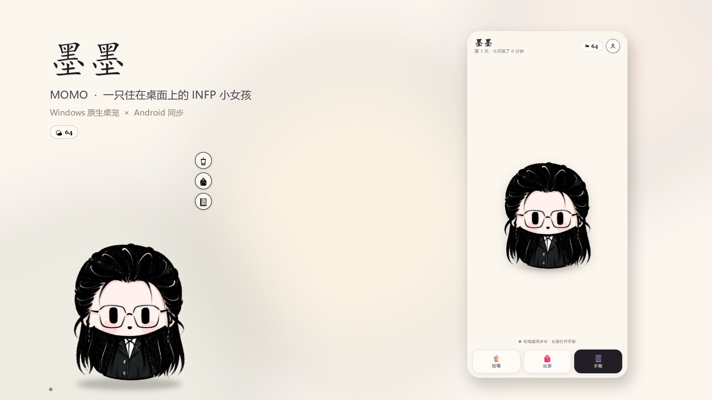

---

## 她现在会的事

| | |
|---|---|
| **摸摸她** | 单击会回应一句 INFP 式的、轻轻的台词；换时间、换心情，说的话也不一样。 |
| **连续戳** | 连按会变成「。」，按得越多「。」越长；戳太狠会晕、会轻轻抗议，停手后还会小声原谅你。 |
| **账号** | 第一次打开先创建账号，或登录已有账号。每个账号有独立的心情、饱食度、健康值、疲惫值、投喂/运动/出游记录，账号和密码绑定，密码只以加盐哈希保存。 |
| **投喂** | 奶茶、炸串、可乐、小蛋糕，以及**麻辣烫、巧克力、冰淇淋**。可选糖度、辣度、汤底、口味；她会用小女孩的口吻评价「太甜啦」「太辣啦」「太淡啦」。每次投喂会少量增加健康值。 |
| **出游** | 公园 / 游乐场 / 江边 / 旧书店，10 分钟或半小时。不同地点有不同对话；她按现实时间自己走完，关掉程序也不会作弊；回来会带一片叶子、一张车票、一段**路上遇到的小惊喜**，并写进手账，同时增加一点疲惫值。 |
| **运动** | 跑步 / 跳绳 / 散步 / 拉伸，3 / 5 / 10 / 30 分钟。运动时不能打扰她，但可以中断；点击显示「正在挥汗如雨」之类的状态，右键（手机点「让她停下」）可中断。健康值大量增加，疲惫值也明显增加，行为会写进主页。 |
| **健康与疲惫** | 健康值、疲惫值独立显示在手账里。吃太饱/运动过度/太累都有自己的状态；疲惫值会随休息慢慢恢复，疲惫太高时她会拒绝运动。 |
| **小屋背景** | 初始是温馨的「家」，点击主界面右上角的背景图标，可换成「窗边 / 雨夜 / 小花园」。背景跟着账号同步，电脑和手机会看到她待在同一间屋子里。 |
| **个人页面** | 心情值、饱食度、健康值、疲惫值、今日陪伴时长、累计被戳 / 投喂 / 运动 / 出游、周视图陪伴日历（可滑动/打开月历）、投喂记录、运动记录、出游手账、账号与同步、设置。 |
| **桌面感** | 无边框透明窗口、始终置顶、可拖动、透明区域点击穿透、托盘、开机启动、右键菜单。 |

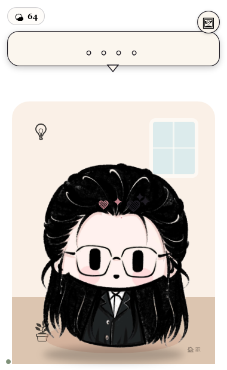

---

## 马上运行（Windows）

打包好的程序在：

```
dist/MomoPet-Setup-1.2.0.exe        ← 给别的电脑装，带卸载器
dist/MomoPet-Windows-Portable/      ← 免安装便携版
dist/MomoPet-Android-1.2.0.apk      ← 安卓安装包
```

Windows 用户推荐直接运行 `MomoPet-Setup-1.2.0.exe`，会安装到 `%LOCALAPPDATA%\Programs\MomoPet` 并创建桌面/开始菜单快捷方式。便携版则解压后：

- **推荐**：双击 `启动墨墨.cmd`。它会带上随包的 .NET 运行时，不要求电脑预装 .NET。
- `启动墨墨.vbs` 是无窗口版；部分电脑禁用了 Windows Script Host，双击 VBS 会没反应——这时用 `启动墨墨.cmd` 就好。
- 也可以直接运行 `MomoPet.exe`（需要系统已安装 .NET 10 Desktop Runtime）。
- 轻量版（不附带 .NET 运行时）在 `dist/MomoPet-Windows/MomoPet.exe`，体积更小。

第一次启动会先出现**登录 / 创建账号**窗口。创建账号后会回到登录页，再输入一次密码即可进入：

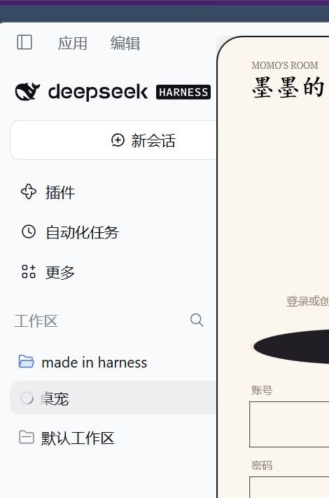

登录后她才出现在屏幕右下角。以后会记住账号，直接进入。

如果 `启动墨墨.cmd` 打开后没有出现窗口，黑窗口会停住并显示原因；也可以直接双击 `MomoPet.exe`（需要系统已装 .NET 10），或把同目录的 `startup.log` 发给我。

> 程序可以整个文件夹搬到别的目录；账号、密码、设置和记录默认保存在 **`%LOCALAPPDATA%\MomoPet\data`**，升级/替换程序文件夹不会丢。旧版放在程序旁的 `data\` 或 `desktop-settings.json` 会在第一次启动时自动迁移到新位置。

### 桌面端操作

| 操作 | 效果 |
|---|---|
| 左键单击 | 摸她，回应一句话 |
| 快速连按 | 气泡变成越来越多的「。」 |
| 按住拖动 | 在初始界面拖她的房间/她本人；打开手账、投喂、运动面板后，拖面板顶部的标题栏，也能移动整个窗口 |
| 右键 | 菜单：个人页面 / 喂她吃点 / 出门走走 / 运动一下 / 和她说说话 / 声音 / 藏起来 / 退出；运动时菜单第一项是「中断运动」 |
| 悬停右侧 | 投喂、出游、运动、手账四个快捷按钮 |
| 双击 | 打开个人页面 |
| 托盘图标 | 单击显示 / 隐藏，双击打开手账 |

---

## 账号与手机同步

Android 端提供两种方式：

- **APK**：`dist/MomoPet-Android-1.2.0.apk`，安装后第一次填写电脑上显示的地址（如 `http://192.168.1.8:8787`），再登录账号。
- **PWA**：手机 Chrome 打开同一个地址，添加到主屏幕。

两种方式共用同一套界面和账号，数据实时同步。

1. 电脑和手机连**同一个 Wi-Fi**。
2. 第一次在电脑上打开墨墨时，创建账号（例如 `momo` / 自己的密码）。
3. 电脑上右键墨墨 → `个人页面` → `账号与同步`，看到局域网地址，例如：
   ```
   http://192.168.1.8:8787/
   ```
4. 用手机 Chrome 打开这个地址，**登录同一个账号**（账号和密码要和电脑上一致）。如果还没有账号，也可以在手机上直接创建一个。

   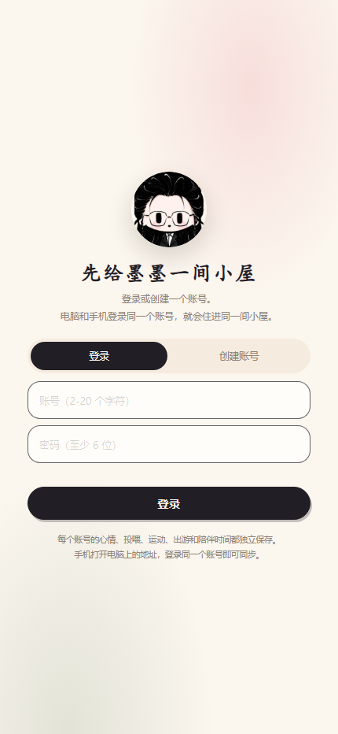

5. 打开后建议：Chrome 右上角菜单 → **添加到主屏幕**，这样下次像 App 一样打开。

同步之后：

- 手机上喂她一杯奶茶，电脑上的健康值/心情几秒内会变；
- 电脑上带她运动或出门，手机上会看到倒计时和「挥汗如雨」；
- 陪伴时间会把两台设备的时间合在一起算（不会重复计算）；
- 关掉手机页面，她还在电脑上；电脑关掉，手机就连不上这间小屋。

> **每个账号的数据是独立的。** 同一个服务器上可以创建多个账号；退出账号后重新登录另一个账号，会进入另一间小屋。  
> **限制**：这一版需要电脑开着、手机和电脑在同一网络；账号保存在 `%LOCALAPPDATA%\MomoPet\data`，没有云端同步。APK / 安装包说明见 [docs/ANDROID.md](docs/ANDROID.md)。  
> PWA 完整安装（带离线缓存）需要 HTTPS 或 localhost；局域网 HTTP 下 Chrome 仍然可以「添加到主屏幕」，只是更像一个快捷方式。

---

## 她吃点什么

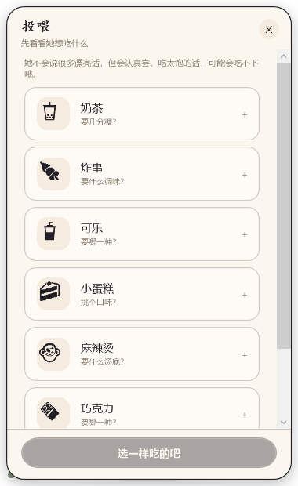

| 吃的 | 可选 | 她会说 |
|---|---|---|
| 奶茶 🧋 | 无糖 / 三分 / 五分 / 七分 / 全糖 | 「太淡啦，像一句没有说完的晚安。」「太甜啦！舌头都要黏住了……」 |
| 炸串 🍢 | 不辣 / 微辣 / 中辣 / 特辣 / 孜然 / 甜辣 | 「特辣……你是想看我出丑吗？呜。」 |
| 可乐 🥤 | 经典 / 零度 / 樱桃 / 香草 | 「零度的可乐……太淡啦。」 |
| 小蛋糕 🍰 | 草莓 / 巧克力 / 抹茶 | 「抹茶有一点点涩。我喜欢这种不讨好的味道。」 |
| 麻辣烫 🍲 | 微辣 / 中辣 / 特辣 / 番茄 / 骨汤 | 「太辣啦——！这已经不是麻辣烫，是岩浆吧。」 |
| 巧克力 🍫 | 黑巧 / 牛奶 / 榛果 / 草莓夹心 | 「牛奶巧克力……太甜啦。可是我还是想吃第二块。」 |
| 冰淇淋 🍦 | 香草 / 草莓 / 抹茶 | 「好凉……舌头都没知觉了。但是很甜。」 |

饱食度会随时间下降；太饱时她会拒绝。每次投喂都会**少量增加健康值**，具体数值写在投喂记录里。

## 她去哪里

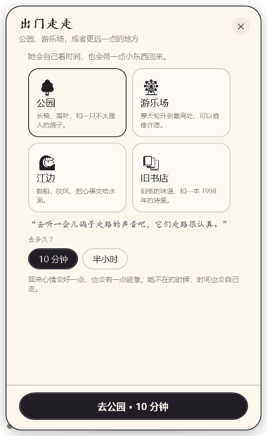

| 地方 | 10 分钟 | 半小时 |
|---|---|---|
| 公园 🌳 | 心情 +8 左右，疲惫 +2 | 心情 +20 左右，疲惫 +5 |
| 游乐场 🎡 | 心情 +11 左右，疲惫 +2 | 心情 +26 左右，疲惫 +5 |
| 江边 🌊 | 心情 +9 左右，疲惫 +2 | 心情 +22 左右，疲惫 +5 |
| 旧书店 📚 | 心情 +10 左右，疲惫 +2 | 心情 +24 左右，疲惫 +5 |

不同地点有各自的**预览台词**和**出游中台词**；在手机上点「看看她」，或在电脑上点她，会听到那个地点专属的话。

出游是**按时间戳离线结算**的：她出门后可以关掉程序、关掉手机，回来再打开，时间照样走完。回来会有一张「出游手账」，记录她去了哪、待了多久、心情变化、带回来的小东西，以及**那只蹭过来的猫、那张旧车票、那个多给她一颗山楂的爷爷**之类的小惊喜。手账里会保留最近几次出游。

## 陪她运动

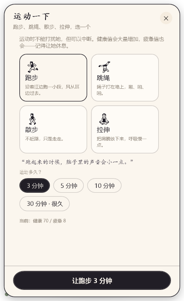

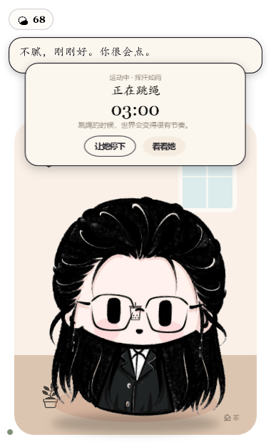

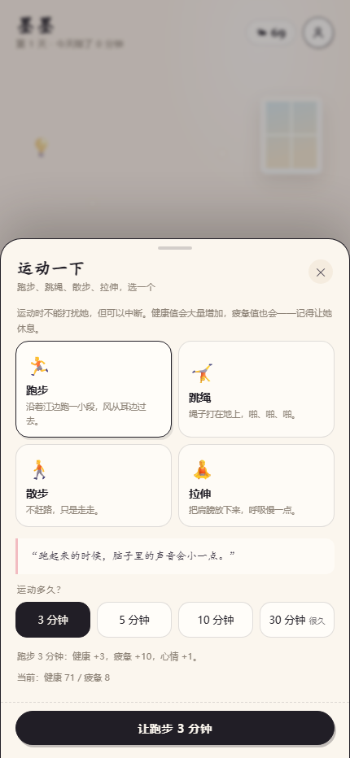

| 运动 | 3 分钟 | 5 分钟 | 10 分钟 | 30 分钟 |
|---|---|---|---|---|
| 跑步 🏃 | 健康 +3 / 疲惫 +10 | +5 / +17 | +9 / +27 | +20 / +54 |
| 跳绳 🤸 | 健康 +3 / 疲惫 +12 | +5 / +19 | +10 / +30 | +22 / +60 |
| 散步 🚶 | 健康 +2 / 疲惫 +5 | +3 / +9 | +6 / +16 | +14 / +32 |
| 拉伸 🧘 | 健康 +2 / 疲惫 +4 | +4 / +7 | +7 / +12 | +16 / +24 |

- 运动期间她会一边喘气一边轻轻跳，身上会冒汗、嘴边的话也会换；你点她，她会回应「正在跑步……汗水要滴到眼睛里了」之类的话。
- 右键（手机点「让她停下」）可以中断；提前停下只能拿到一部分健康值，但这次运动会被记录。
- 运动结束会出现一张「运动记录」，健康、疲惫、心情变化都写进手账。
- 疲惫值 ≥ 85 时她会拒绝新的运动；休息一段时间会慢慢恢复。

---

## 个人页面

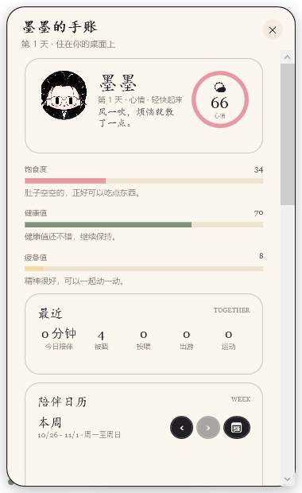

- 心情环 + 心情标签 + 饱食度 / 健康值 / 疲惫值
- 今日陪伴分钟数、在一起第几天
- 累计被戳 / 投喂 / 运动 / 出游
- 陪伴日历：默认显示本周周一到周日，左右滑动/箭头查看之前的周；点日历可以看到所有日子
- 最近投喂记录（带她的原话和健康变化）
- 运动记录（含提前停下、健康/疲惫变化）
- 出游手账（地点、时长、心情、路上遇到的小惊喜）
- 账号与同步：当前账号、局域网地址、复制地址、退出账号
- 设置：声音、始终置顶、开机启动、回到右下角、重新开始

主界面右上角的背景图标可以换小屋背景；手账里的陪伴日历可以左右滑动看之前的周，点「日历」能看到所有日子。

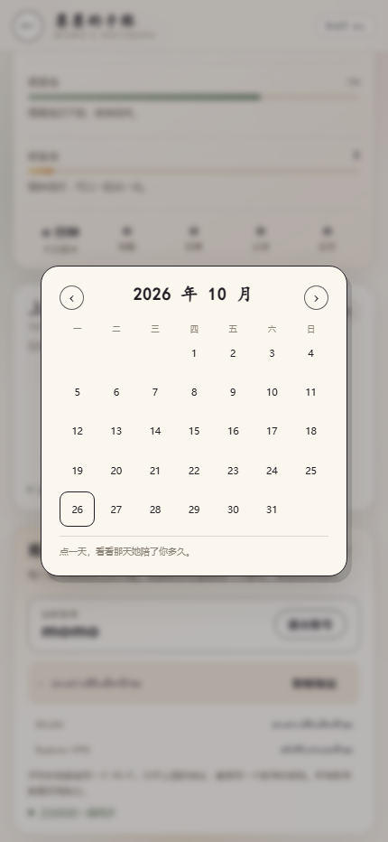

手机上的手账页是长滚动版：`docs/images/mobile-profile.png`。

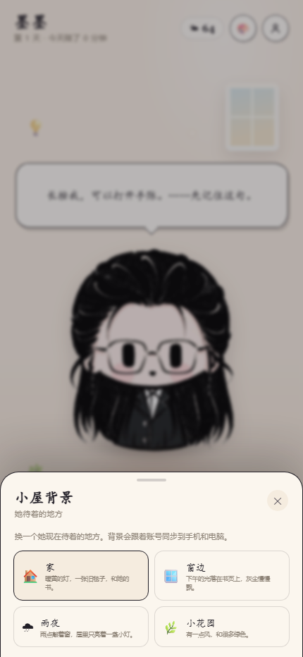

---

## 数据是怎么互通的

```
┌──────────────────────┐        HTTP / SSE        ┌──────────────────────┐
│  Windows 原生桌宠     │  ◄──────────────────►   │  Node 同步服务端      │
│  WPF（透明置顶窗口）  │      每 4 秒轮询状态      │  零依赖，端口 8787     │
└──────────────────────┘                          │  账号 + 每账号 JSON    │
                                                  └──────────┬───────────┘
┌──────────────────────┐        HTTP / SSE                   │
│  Android Chrome PWA  │  ◄──────────────────────────────────┘
│  同一套 web/ 界面     │        登录同一个账号
└──────────────────────┘
```

- **账号**：用户名 + 密码注册；密码使用 `scrypt` 加盐哈希，账号文件里没有明文密码。登录后发一个随机 token，桌面端存在 `desktop-settings.json`，手机存在 `localStorage`。
- **数据隔离**：每个账号一个 `%LOCALAPPDATA%\MomoPet\data\states\<账号ID>.json`，心情/投喂/运动/出游/陪伴时间完全独立；SSE 只向该账号的客户端推送。
- **服务端**：`server/server.js`，零第三方依赖。PC 端启动时自动拉起，数据固定保存在 `%LOCALAPPDATA%\MomoPet\data`；旧版程序旁的 `data\` 会自动迁移过来。
- **PC 端**：`desktop-native/`，WPF 原生窗口 + 内置 Node 服务端 + 登录窗口。每 4 秒拉取一次状态，所以手机上的操作几秒内就能看到。
- **手机端**：`web/` 同一套页面，SSE 实时推送，心跳每 15 秒。
- **陪伴时间**：服务端按心跳去重累计，两台设备同时开着也只算一份。
- **所有心情/饱食度/健康/疲惫/投喂/运动/出游数值**都由服务端计算，客户端只负责表现，避免两头各算一套。

---

## 目录结构

```
.
├─ desktop-native/              Windows 原生桌面端（WPF, .NET 10）
│  ├─ MainWindow.xaml(.cs)      透明桌宠窗口、点击/连按、投喂、运动、出游、手账
│  ├─ AuthWindow.xaml(.cs)      登录 / 创建账号窗口
│  ├─ ServerHost.cs             启动/关闭内置 Node 服务端
│  ├─ ApiClient.cs              账号 token + HTTP + JSON 状态同步
│  ├─ Assets/                   透明立绘、头像、图标
│  └─ node/node.exe             随包 Node（MIT）
├─ server/server.js             零依赖同步服务端（账号 + HTTP API + SSE + 静态站点）
├─ shared/
│  ├─ content.js                全部台词、食物选项、运动/出游地点、手账文案
│  └─ engine.js                 心情/饱食度/健康/疲惫/投喂/运动/出游/陪伴时间的纯逻辑
├─ web/                         桌面浏览器与 Android PWA 共用的界面
│  ├─ index.html  css/  js/     桌宠、投喂、运动、出游、手账、账号登录
│  └─ assets/                   透明立绘、头像、图标
├─ tools/
│  ├─ prepare_assets.py         去白底、切头像、生成图标
│  ├─ build-native.ps1          重新发布 Windows 便携版
│  └─ capture.mjs               Chrome 无头截图 / 交互回归
├─ docs/
│  ├─ ANDROID.md                APK 安装、PWA 安装与打包说明
│  └─ images/                   README 截图
├─ dist/
│  ├─ MomoPet-Windows-Portable/ 推荐：双击 启动墨墨.cmd
│  ├─ MomoPet-Windows/          轻量版：需要 .NET 10 Desktop Runtime
│  └─ ...                       数据在 %LOCALAPPDATA%\MomoPet\data（升级不丢）
├─ test/                        接口回归与环境检查
└─ start-server.cmd             只启动服务端（给手机用，或开发调试）
```

---

## 从源码运行 / 重新打包

### 环境

- **.NET 10 SDK**（WPF，Windows）
- **Node.js 22+**（源码仓库不包含 265MB 的 `dist/` 和内置 `node.exe`；发布便携版前把 `node.exe` 放到 `desktop-native/node/node.exe`，或设置 `MOMO_NODE` 指向已安装的 node）
- **Python 3 + Pillow**（只在重新生成素材时需要）

### 本地运行

```powershell
dotnet run --project desktop-native/MomoPet.csproj
```

第一次运行会先创建账号。

### 只跑服务端 + 浏览器界面

```powershell
# 安装 Node.js 22+ 后
node server\server.js

# 浏览器打开 http://127.0.0.1:8787/
# 注册账号，或用同一个账号在另一台设备打开
```

### 重新发布便携版

```powershell
# 先把 node.exe 放到 desktop-native\node\node.exe，或设置 MOMO_NODE
powershell -ExecutionPolicy Bypass -File tools\build-native.ps1
```

会重新生成：

- `dist/MomoPet-Windows`：框架依赖版
- `dist/MomoPet-Windows-Portable`：带私有 .NET 运行时 + `启动墨墨.cmd` / `启动墨墨.vbs`

### 重新生成立绘素材

```powershell
python tools\prepare_assets.py
```

从 `assets-src/portrait.jpg` 去白底、羽化边缘、切头像和图标，输出到 `web/assets/` 与 `desktop-native/Assets/`（脚本会覆盖同名文件，再重新发布即可）。

### 测试

```powershell
node test\api-test.js          # 账号 / 数据隔离 / 投喂 / 运动 / 出游 / 持久化
node tools\capture.mjs mobile  # 用 Chrome 无头跑移动端交互并截图
node tools\capture.mjs auth    # 手机端登录界面
node tools\capture.mjs profile
```

---

## 已知限制

1. **Android APK 是轻量 WebView 壳**：它连接电脑上运行的墨墨服务端，不内置 Node/账号数据；电脑关机或不在同一 Wi-Fi 时无法使用。也可以继续用 PWA 方式。
2. **同步依赖局域网**：PC 端内置服务端，手机需要和 PC 在同一 Wi-Fi；公网访问需要把 `server/` 单独部署到可访问的机器上。账号系统已经做了，但当前没有云端账号服务。
3. **HTTP 下的 PWA**：Chrome 对局域网 HTTP 页面不提供完整安装/SW 能力；「添加到主屏幕」可用，但离线缓存需要 HTTPS 或 `localhost`。
4. **系统表情**：Windows 的 WPF 会把 emoji 渲染成单色线稿（这正是当前视觉的一部分）；不同 Windows 版本的字体略有差异。
5. **桌面端只在 Windows 上测试**：WPF 窗口透明、置顶、穿透、托盘均按 Windows 10/11 实现。

---

## 素材与许可

- 角色形象来自你提供的参考图；版权归你。
- 程序代码：MIT，见 [LICENSE](LICENSE)。
- 内置运行时：Node.js（MIT）、.NET / WPF（MIT）；详见 [THIRD_PARTY.md](THIRD_PARTY.md)。
